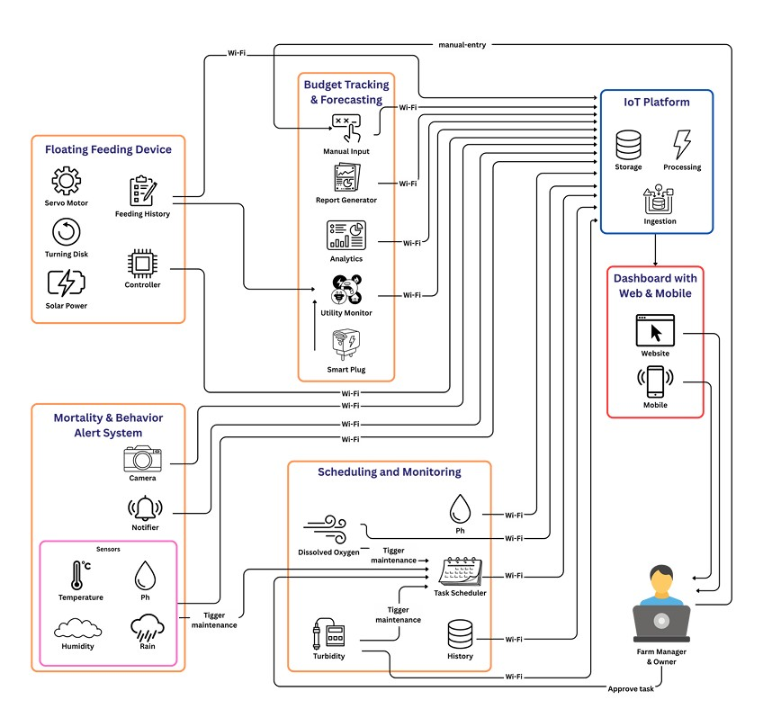

# Koi Fish Friend - Login & Credential Update System

A full-stack application with Spring Boot backend and React frontend featuring a demo login system and credential update functionality.



## Tech Stack

### Backend

- **Spring Boot 3.5.6** (Java 21)
- **Spring Data JPA**
- **MySQL Database**
- **Spring Security** (BCrypt password encryption)
- **Maven**

### Frontend

- **React 19** with TypeScript
- **Vite** (Build tool)
- **React Router DOM** (Navigation)
- **Axios** (HTTP client)
- **Tailwind CSS** (Styling)

## Database Configuration

- **Host:** 82.197.82.97
- **Database:** u626686198_fishfeed
- **Username:** u626686198_fishfeedu
- **Password:** FrevCf&1:2

## Demo Credentials

- **Username:** admin
- **Password:** admin123

These credentials are automatically created when the backend starts for the first time.

## Project Structure

```
koi-fish-friend/
├── backend/
│   ├── src/main/java/com/example/backend/
│   │   ├── config/
│   │   │   ├── SecurityConfig.java
│   │   │   └── DataInitializer.java
│   │   ├── controller/
│   │   │   └── AuthController.java
│   │   ├── dto/
│   │   │   ├── LoginRequest.java
│   │   │   ├── UpdateCredentialsRequest.java
│   │   │   └── ApiResponse.java
│   │   ├── entity/
│   │   │   └── User.java
│   │   ├── repository/
│   │   │   └── UserRepository.java
│   │   └── BackendApplication.java
│   └── pom.xml
└── frontend/
    ├── src/
    │   ├── pages/
    │   │   ├── Login.tsx
    │   │   └── Dashboard.tsx
    │   ├── services/
    │   │   └── api.ts
    │   ├── App.tsx
    │   └── main.tsx
    └── package.json
```

## Setup & Installation

### Prerequisites

- Java 21
- Maven 3.x
- Node.js 18+ and npm
- MySQL database (already configured remotely)

### Backend Setup

1. Navigate to the backend directory:

   ```bash
   cd backend
   ```

2. Build the project:

   ```bash
   ./mvnw clean install
   ```

3. Run the Spring Boot application:

   ```bash
   ./mvnw spring-boot:run
   ```

   The backend will start on `http://localhost:8080`

### Frontend Setup

1. Navigate to the frontend directory:

   ```bash
   cd frontend
   ```

2. Install dependencies:

   ```bash
   npm install
   ```

3. Start the development server:

   ```bash
   npm run dev
   ```

   The frontend will start on `http://localhost:5173`

## API Endpoints

### POST /api/login

Login with username and password.

**Request Body:**

```json
{
  "username": "admin",
  "password": "admin123"
}
```

**Response:**

```json
{
  "success": true,
  "message": "Login successful"
}
```

### POST /api/update-credentials

Update username and/or password for the current user.

**Request Body:**

```json
{
  "currentUsername": "admin",
  "newUsername": "newadmin",
  "newPassword": "newpassword123"
}
```

**Response:**

```json
{
  "success": true,
  "message": "Credentials updated successfully"
}
```

## Features

### Login Page

- Username and password input fields
- Form validation
- Error handling
- Demo credentials displayed
- Redirects to dashboard on successful login

### Dashboard Page

- Update username (optional)
- Update password (optional)
- Password confirmation
- Success/error messages
- Automatic logout after credential update
- Logout button

### Security Features

- BCrypt password encryption
- CORS enabled for frontend
- Session management using sessionStorage
- Password confirmation validation

## Usage Flow

1. **Login:**

   - Open `http://localhost:5173/login`
   - Enter demo credentials (admin / admin123)
   - Click Login button
   - Redirected to Dashboard

2. **Update Credentials:**

   - On Dashboard, enter new username and/or password
   - Confirm new password if changing
   - Click Update Credentials
   - Automatically logged out after 2 seconds
   - Login again with new credentials

3. **Logout:**
   - Click Logout button on Dashboard
   - Redirected to Login page

## Environment Variables

### Frontend (.env)

```
VITE_API_URL=http://localhost:8080
```

### Backend (application.properties)

```properties
spring.datasource.url=jdbc:mysql://82.197.82.97:3306/u626686198_fishfeed
spring.datasource.username=u626686198_fishfeedu
spring.datasource.password=FrevCf&1:2
```

## Development

### Backend

- The application uses JPA with `ddl-auto=update` for automatic schema updates
- Demo user is created automatically on startup
- CORS is configured to accept requests from `http://localhost:5173`

### Frontend

- Hot module replacement (HMR) enabled
- TypeScript for type safety
- Tailwind CSS for responsive design
- React Router for navigation

## Troubleshooting

### Backend won't start

- Check if Java 21 is installed: `java -version`
- Ensure MySQL connection is working
- Check port 8080 is not in use

### Frontend won't start

- Delete `node_modules` and run `npm install` again
- Check port 5173 is not in use
- Verify .env file exists

### Login fails

- Ensure backend is running
- Check browser console for CORS errors
- Verify database connection

### Database connection issues

- Verify MySQL credentials
- Check if remote database allows your IP
- Test connection using MySQL client

## License

MIT

## Author

Koi Fish Friend Team
